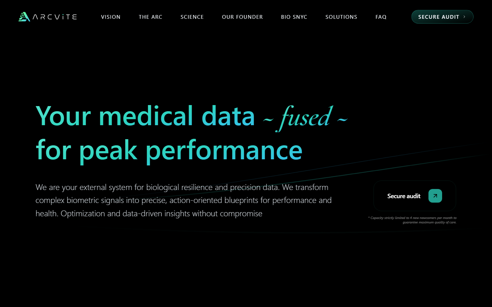
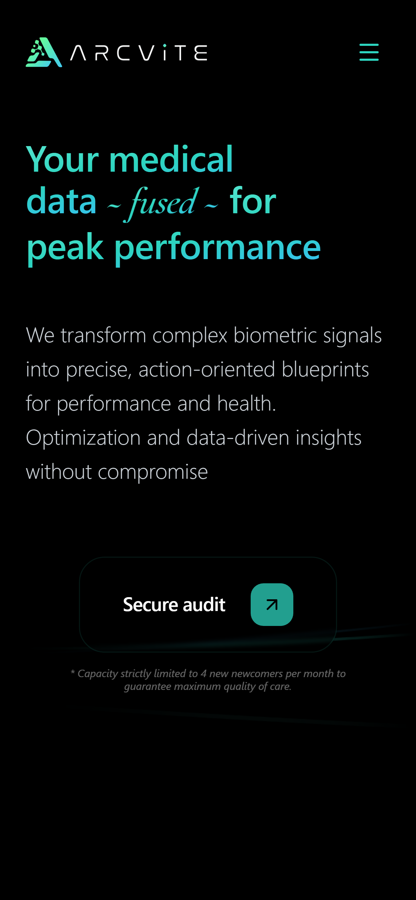

# Arcvite English

An English-language, motion-rich product and application experience for
Arcvite. The site turns a complex health and performance consulting offer into
a focused, responsive journey—from the value proposition and methodology to
protocol details, studies, FAQs, and a validated audit application.

> **Project status:** Active development / pre-release. The application builds
> successfully for production, but this repository does not currently
> contain a deployment workflow or a published English production URL. See
> [Release status and branch strategy](#release-status-and-branch-strategy).

## Preview

<p align="center">
  
</p>

<p align="center">
  
</p>

## Highlights

- Responsive single-page experience with dedicated legal, privacy, study, and
  not-found routes
- Accessible, keyboard-operable interactive methodology, cards, modals,
  navigation, and audit form
- Motion system that respects `prefers-reduced-motion` and pauses expensive
  effects when they are not visible
- Reproducible responsive-image pipeline with AVIF/WebP variants, intrinsic
  dimensions, and lazy loading
- High-coverage Vitest suite plus Playwright tests for real browser behavior,
  accessibility, responsive layouts, touch input, and cross-browser stability
- Automated GitHub Actions quality gate for every push and pull request

## Technology

| Area | Stack | Purpose |
| --- | --- | --- |
| UI | React 19 | Component architecture and application state |
| Build tooling | Vite 8 | Development server, optimized production build, and legacy browser bundles |
| Routing | React Router 7 | Client-side routing and direct-route experiences |
| Motion | Framer Motion 12 | Reduced-motion detection and interface transitions |
| Smooth scrolling | Lenis 1 | Coordinated scroll behavior and scroll-driven visuals |
| Styling | Sass and CSS Modules | Scoped component styles, responsive layouts, and shared design tokens |
| Forms | React Hook Form and Zod | Form state, schema validation, and accessible error feedback |
| Unit/integration tests | Vitest 4, React Testing Library, jsdom | Fast logic, component, hook, and routed integration tests |
| End-to-end tests | Playwright 1.61 and axe-core | Browser flows, device emulation, accessibility, and browser compatibility |
| Delivery | GitHub Actions | Reproducible install, quality checks, build, browser tests, and artifacts |

## Getting started

### Prerequisites

- Node.js 22 (the version used in CI)
- npm

### Installation and development

```bash
git clone https://github.com/LucianoKutger/ArcviteEnglish.git
cd ArcviteEnglish
npm ci
npm start
```

The development server is available at <http://localhost:3000>. Vite also
prints a QR code, which is useful for testing the site on a physical phone on
the same network.

### Production build

```bash
npm run build
npm run preview
```

Vite writes the production bundle to `build/`. The included `.htaccess`
fallback supports direct requests to React Router routes on compatible Apache
hosting.

### Responsive image generation

```bash
npm run images:generate
```

This regenerates the checked-in AVIF and WebP variants in
`src/assets/optimized/`. It expects the untracked local source images in
`orginalAssets/`; those originals are not required to install, test, or build
the application.

## Testing strategy

The test pyramid separates fast feedback from browser-level confidence while
keeping the same user-visible behavior covered at the appropriate boundary.

### Unit tests

Vitest runs pure logic and isolated behavior in jsdom. This layer covers form
validation, methodology geometry and interaction state, page-activity helpers,
responsive-image data, carousel calculations, and browser API fallbacks. Shared
mocks make observers, animation frames, scrolling, media queries, layout,
visibility, and canvas behavior deterministic.

```bash
npm test
npm run test:watch
npm run test:coverage
```

Coverage is enforced in `vitest.config.js`, not merely reported:

| Metric | Minimum |
| --- | ---: |
| Statements | 98% |
| Branches | 95% |
| Functions | 100% |
| Lines | 99% |

### Integration tests

React Testing Library exercises components and sections as users interact with
them. Tests render real component trees with router context and verify routed
navigation, modal lifecycles, audit-form feedback, accessible state, responsive
carousel behavior, reduced-motion handling, and coordination between visual
effects. Integration tests live beside the source as `src/**/*.test.{js,jsx}`
and run as part of the Vitest commands above.

### End-to-end tests

Playwright starts the actual Vite application and verifies complete flows in a
real browser. The suite covers:

- routing, direct navigation, the mobile menu, section navigation, and 404s;
- the audit application and other product interactions;
- responsive layouts, touch gestures, and iPhone 13 portrait/landscape
  emulation;
- reduced-motion behavior and WCAG A/AA checks with axe-core;
- UI regression risks, runtime errors, asset health, and browser quality;
- cross-browser smoke flows in Chromium, Firefox, and WebKit (Safari's browser
  engine).

Chromium runs the complete E2E suite. Focused compatibility scenarios are also
executed in Firefox and WebKit, giving broad coverage without tripling every
test's runtime.

```bash
npx playwright install chromium firefox webkit
npm run test:e2e
npm run test:e2e:headed
npm run test:e2e:ui
npm run test:e2e:report
```

For the complete local quality gate:

```bash
npm run full_test
```

This runs coverage, ESLint, the production build, and Playwright in sequence.

## CI/CD quality gate

`.github/workflows/ci.yml` runs on every push, on pull requests targeting
`dev` or `main`, and on manual dispatch. Concurrent runs for the same ref are
cancelled so that feedback reflects the newest commit.

The pipeline has three stages:

1. **Quality:** checks out the repository, installs the lockfile with `npm ci`
   on Node.js 22, enforces Vitest coverage thresholds, runs ESLint, and creates
   the production build.
2. **End-to-end:** runs only after quality succeeds, installs Chromium,
   Firefox, and WebKit with their system dependencies, then executes the
   Playwright suite.
3. **CI Gate:** fails unless both upstream jobs completed successfully. This is
   the single check intended for branch-protection rules.

Coverage and Playwright HTML reports are retained as workflow artifacts for 14
days. Traces, screenshots, videos, and test results are retained on Playwright
failures, making browser-only regressions reproducible instead of opaque.

## Engineering case study: Mobile Safari performance

### Context and analysis

The visual direction combines a high-density animated canvas, large ambient
glows, scroll-driven transitions, responsive imagery, and interactive overlays.
That combination is particularly demanding on Mobile Safari: a high device
pixel ratio increases canvas work, large blur and blend layers increase GPU
compositing, and multiple off-screen animation loops can continue consuming
resources during a long page scroll.

The performance pass treated this as a rendering-budget problem rather than a
single slow component. The investigation followed the expensive work across
canvas resolution, frame scheduling, CSS compositing, scroll subscriptions,
image delivery, document visibility, and overlay state. WebKit cross-browser
tests and iPhone-sized touch/device-emulation scenarios protect the resulting
behavior. The repository does not contain a committed benchmark baseline, so
this case study deliberately reports the technical changes and their expected
impact rather than inventing an FPS or Lighthouse improvement.

### Implemented optimizations

- **Bounded canvas cost:** the hero canvas caps its device-pixel ratio at `1.5`,
  limits drawing to roughly 60 fps on high-refresh displays, and caps large
  frame deltas after interruptions.
- **Less compositing pressure:** expensive blurred, screen-blended glow layers
  were replaced with radial gradients where possible; redundant blend modes
  and the global noise overlay were removed.
- **Viewport-aware animation:** `IntersectionObserver`-based activity hooks
  pause the canvas, background glows, methodology motion, and scroll tracking
  outside a configurable viewport margin.
- **Lifecycle-aware work:** visual effects pause when the document is hidden or
  a modal is open, then resume without creating duplicate animation loops.
- **Cheaper scroll updates:** fade layers subscribe to Lenis and update DOM
  transforms/opacities directly instead of introducing React renders for every
  scroll position.
- **Responsive image delivery:** AVIF/WebP source sets serve size-appropriate
  assets; lazy loading and intrinsic dimensions reduce transferred bytes and
  prevent avoidable layout shifts.
- **Progressive motion:** route-level code splitting reduces initial work, while
  `prefers-reduced-motion` disables smooth scrolling and provides static visual
  fallbacks.
- **Regression protection:** Vitest verifies DPR limits, frame throttling,
  observer lifecycles, hidden-document behavior, and browserless fallbacks;
  Playwright verifies touch layouts, reduced motion, and WebKit compatibility.

### Outcome

The optimized path reduces pixel fill, active animation loops, off-screen
subscriptions, and costly compositing layers while preserving the original
visual identity. Just as importantly, the performance decisions are encoded in
automated tests, so they remain architectural constraints rather than one-off
tweaks.

## Architecture

```text
src/
├── components/
│   ├── cards/          # Reusable interactive content cards
│   ├── sections/       # Page sections and audit form flow
│   ├── ui/             # Navigation, inputs, modal, and responsive image
│   └── visuals/        # Canvas, glow, methodology, and scroll effects
├── data/               # Domain content and responsive image manifests
├── hooks/              # Viewport and visual-activity lifecycles
├── test-utils/         # Router helpers and deterministic browser API mocks
├── utils/              # Interaction, geometry, and page-activity logic
└── validation/         # Audit form schema and validation helpers

e2e/                    # Playwright user journeys and browser checks
scripts/                # Reproducible asset-generation tooling
.github/workflows/      # CI quality gate
```

## My role and contribution

I built this repository as the responsible frontend engineer, covering the
implementation from application architecture to browser quality. My ownership
included:

- translating the visual concept into a responsive React component system;
- migrating the toolchain from Create React App to Vite and from Jest-based
  tooling to Vitest;
- implementing routing, motion, smooth scrolling, forms, accessibility, and
  responsive/touch interactions;
- building the responsive asset pipeline and leading the Mobile Safari
  rendering-performance pass;
- designing the unit, integration, and E2E strategy, including cross-browser
  and accessibility coverage; and
- creating the GitHub Actions pipeline and its enforced quality gate.

Repository history records the work under two variants of the same contributor
identity (`Luciano.kutger` and `Luciano Kutger`).

## Release status and branch strategy

The application is in active pre-release development. It has a production
build, strict automated quality checks, direct-route support, responsive/touch
coverage, and cross-browser tests. It is **not yet published from this
repository**, and no deployment job or public English URL is configured here.

The current default branch is `dev`, while `main` trails the tested
implementation. For a public portfolio repository, `main` should be the stable,
reviewed branch and the default landing point; `dev` should remain the
integration branch.

Recommended release sequence:

1. Confirm that the latest `dev` pipeline is green.
2. Merge or fast-forward `dev` into `main` through a reviewed pull request.
3. Protect `main` with the required **CI Gate** check.
4. Set `main` as the GitHub default branch.
5. Add the chosen deployment target and production URL to this README.

Until those steps are complete, `dev` is the most current implementation and
`main` should not be presented as the public release.
